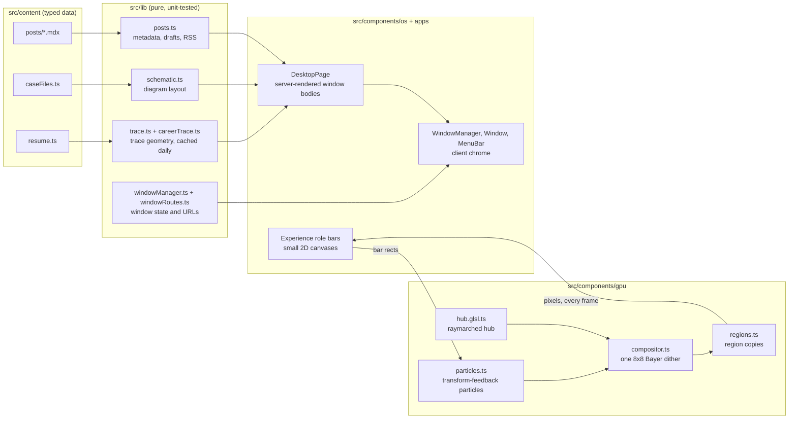

# jaredmchester.com

My portfolio, built as a one-person desktop OS in two inks, with a single GPU scene running behind the windows.

[Live site](https://jaredmchester.com) · [Design doc](docs/design.md)

[](https://github.com/jmc07712/personal-site/actions/workflows/ci.yml)

## What it is

The whole site is one desktop drawn in exactly two inks: paper `#C9CEBB` and ink `#262E1B`. Every grey is a 1-bit dither of those two.

- **Desktop.** About, Experience, Writing, Contact and one window per side project (Counterdex, Docly, DateEscape). Windows drag, close, reopen and stack. The menubar has real dropdown menus (Radix Menubar) for opening windows, pausing the scene, About This Computer, Restart and Shut Down. Escape closes the focused window. On large monitors the whole interface scales up in steps (`--ui`), so a 2560 or 4K screen shows the laptop layout at a larger size.
- **Experience.** My career as a distributed-trace waterfall: roles are spans, the systems I built are child spans. Selecting a span shows its numbers in an inspector.
- **Case files.** Each of the ten systems in the trace has a case file: the problem, what I built, an architecture diagram, key decisions and impact. Every case file has its own URL at `/work/<slug>`. Opening one pushes the URL and Back closes it.
- **Writing.** An MDX blog at `/blog` and `/blog/<slug>`, with an RSS feed at `/feed.xml`.
- **Pocket mode.** At 768px and below the same page becomes a pocket computer. A home screen shows the agent large with an app grid, every section stays a framed window over the live wallpaper, the trace becomes an accordion, and a dock sits in the thumb zone. The scene is lighter and sleeps when idle.

Behind the windows, WebGL2 draws a raymarched "agent hub" and 262,144 particles through one dither. The hub stands for the agent work I do now; the particles stand for the data scale behind it.

## How it works



Content is plain TypeScript and MDX. Pure functions in `src/lib` turn it into geometry, layouts and routes. `DesktopPage` renders every window body on the server. Client components add the chrome (focus, stacking, dragging, URL sync) and the few interactive parts inside windows, such as the trace and Contact's copy button. The scene runs underneath all of it, and the only things that cross between it and React are a pointer, a mode and a list of rectangles.

### The scene: one GPU, one dither

`src/components/gpu/renderer.ts` is a framework-free class and the scene's state machine (`boot`, `wallpaper`, `experience`). Each frame runs three passes:

1. **Simulate** (`particles.ts`, `shaders/sim.glsl.ts`). A vertex shader with transform feedback moves every point. Position and velocity are double-buffered on the GPU, so the CPU only sends a few dozen uniforms per frame. Each point springs toward a target that blends three formations (my name during the boot, a slot on a hub tether, a slot in a role bar), and curl noise from `shaders/noise.glsl.ts` carries the loose ones.
2. **Splat** (`shaders/splat.glsl.ts`). Each point adds its ink to one cell of a half-float buffer with additive blending.
3. **Composite** (`compositor.ts`, `shaders/composite.glsl.ts`, `shaders/hub.glsl.ts`). One fragment per cell raymarches the OpenAI knot as a rounded extrusion, with six small tool nodes on tethers, multiplies in the splatted ink, and reduces the result to two inks with one 8x8 Bayer threshold. The knot turns slowly with a slight tilt so its openings stay visible. Its silhouette comes from the [official OpenAI Blossom SVG](https://openai.com/brand/), precomputed into a 256×256 R8 distance texture shared by WebGL and the CPU still. Run `node scripts/generate-blossom.mjs` to regenerate it from `assets/openai-blossom.svg`.

Doing the hub and the points in one dither is what keeps the scene one image: particles melt into the hub's shading without a seam.

- **Dither.** `bayer.ts` holds the same threshold function on the CPU, and a unit test proves the shader's branch-free form equals the classic recursive 8x8 matrix. The pattern is locked to the page grid, so it doesn't swim when you scroll.
- **Resolution.** Cells are 3 CSS px times the interface scale `--ui`, with device pixel ratio capped at 2. When frames keep running over budget, cells grow 1px at a time up to 5px: resolution gives way before frame rate does.
- **The Experience bars.** Opening Experience pours the particles out of the hub into the role bars; closing it or scrolling away drains them back. The canvas sits beneath every window, so the window's paper would hide anything drawn there. Each bar is instead a small 2D canvas (`GpuRegion.tsx`), and after every frame `regions.ts` copies the matching patch of the scene into it with `drawImage` and no smoothing. The composite cuts the hub out of those rectangles, so the bars show only paper and points, and they layer like the rest of the DOM, including under a window dragged on top.
- **Boot.** On a first desktop visit the particles stream in on a current, spell my name in Jersey 10, then implode into the hub as it dithers in. The windows appear at about 4 s. A click, key, wheel or touch skips it, and it plays once per session (`sessionStorage`). An inline script (`os/bootCurtain.ts`) hides the hero before first paint only when the boot will actually play.
- **Pocket mode.** 32,768 points instead of 262,144, capped at 30fps, 80 raymarch steps instead of 140, and a low-power GPU hint. The scene is a fixed wallpaper behind the windows that never takes a scroll gesture, and it sleeps after 20 s without input until tapped. The boot is a 1.2 s inflow.
- **No WebGL2.** `fallback.ts` raymarches the hub once on the CPU at a coarser 4px pixel and dithers it with the same Bayer matrix: one still frame.
- **Reduced motion.** `prefers-reduced-motion` or Save-Data gives a still frame and no boot. View > Pause scene stops the scene and remembers the choice in `localStorage`.
- **Lifecycle.** The renderer starts once the browser is idle after first paint, stops while the tab is hidden, and rebuilds its GPU resources if the WebGL context is lost and restored.

A visually hidden caption describes the scene for screen readers, computed from the live point count: 1.2 billion Insights API records a month divided by the points, so each point stands for about 4,578 records on desktop and 36,621 in Pocket mode.

### Windows and routes

- `src/lib/windowManager.ts` is a pure reducer (open, close, focus, move), unit-tested without a DOM. Stacking uses an ever-increasing z counter. It counts every open request, even for a window that's already open, so asking again scrolls the window into view and focuses it. Dragged positions survive close and reopen.
- `WindowManager.tsx` holds the reducer in context. `Window.tsx` draws the chrome and drags by the title bar with Motion, only with a fine pointer at 769px and wider. Escape closes the focused window and returns focus to whatever opened it.
- `src/lib/windowRoutes.ts` is the only place that maps windows to URLs: `case:<slug>` to `/work/<slug>` and `post:<slug>` to `/blog/<slug>`. Opening a routed window calls `history.pushState`. Closing it goes back if we pushed the entry, or replaces the URL with `/` after a direct visit. A `popstate` listener makes the open windows match the URL, so Back and Forward work.
- `/work/[slug]` and `/blog/[slug]` use `generateStaticParams`, so every case file and published post is prerendered with its own title, description, canonical URL and Open Graph tags. Each renders the same `DesktopPage` with that window already open.
- Next 16 Cache Components is on (`cacheComponents: true` in `next.config.ts`). The only time-dependent input on the site is "now", the open end of my current role in the trace. `src/lib/careerTrace.ts` computes the trace in a `'use cache'` function with `cacheLife('days')`, so pages stay static, the bars keep up with the calendar without a redeploy, and the client never renders a different month than the server. The feed and sitemap take their dates from the posts instead of the clock, so they prerender too.

### Content as data

- `src/content/resume.ts` holds identity, career spans (roles, systems, the degree) and products. Components never hard-code facts.
- `src/content/caseFiles.ts` holds the ten case files. Each links to a span by `spanId` and declares its diagram as nodes on a coarse grid. `src/lib/schematic.ts` places the nodes and routes edges with right-angle elbows so 1px lines stay crisp; `Schematic.tsx` draws the result as pixel SVG.
- `src/content/types.ts` types all of it.
- Posts are MDX files in `src/content/posts`, registered in `index.ts`. `src/lib/posts.ts` validates each post's `metadata` export when it loads, so a typo fails the build instead of rendering `undefined`. It also sorts posts, filters drafts and builds the RSS feed. Code blocks go through `rehype-pretty-code` with a one-ink Shiki theme defined in `next.config.ts`: syntax is shown with italics and bold only.

### Guardrails as tests

Some of the rules for this site are about content, not code, so they're tests that run in CI.

- **Confidentiality.** `tests/unit/content.test.ts` collects every string in `resume.ts` and `caseFiles.ts`, breaks it into lowercase words and 2- and 3-word phrases, hashes each with SHA-256, and fails on any match in `tests/unit/denylist.ts`. Only the hashes are committed, so the banned terms (internal codenames and the like) never appear in this public repo. The terms themselves live in an untracked `.denylist.local`, one per line. Regenerate the hashes from the repo root with `node scripts/hash-terms.mjs`. The same test fails on anything shaped like a phone number.
- **Copy lint.** The same file bans 25 patterns of filler words and constructions, including the em dash character, from published copy.
- **Diagrams.** Node labels are at most 14 characters so they fit their box, and edges connect existing nodes inside the grid. `tests/unit/schematic.test.ts` lays out every real case-file diagram and fails if any edge passes through a box it doesn't connect.
- **Structure.** Case-file slugs are unique, every system span has a case file, and every case file points at a real span.
- **Boot curtain.** `tests/unit/bootCurtain.test.ts` runs the pre-paint script against a fake browser. It hides the hero on a first desktop visit, and never on phones, with reduced motion, with Save-Data, after the boot has played this session, or while the scene is paused. The script also gives up after 8 s, so content can't stay hidden.

## Project layout

```text
src/
  app/                  routes (App Router)
    page.tsx            /: the desktop
    work/[slug]/        /work/<slug>: the desktop with a case file open
    blog/               /blog and /blog/<slug>: Writing, and a post in the reader
    feed.xml/           RSS 2.0
    layout.tsx          fonts, metadata, JSON-LD, analytics, skip link
    sitemap.ts          home, /blog, every case file and published post
    globals.css         the two ink tokens, dither masks, base type
  components/
    os/                 desktop shell: DesktopPage, WindowManager, Window, MenuBar, icons, Pocket dock
    apps/               window bodies: About, Experience, CaseFile, Schematic, Writing, Post, Product, Contact
    gpu/                the WebGL2 scene, its CPU fallback, and the React provider around it
  content/
    resume.ts           identity, career spans, products
    caseFiles.ts        the ten case files
    posts/              MDX posts and their registry
    types.ts            content types
  lib/
    trace.ts            spans to waterfall geometry
    careerTrace.ts      the trace as of today, cached for a day
    windowManager.ts    window state reducer
    windowRoutes.ts     window id to URL mapping
    schematic.ts        case-file diagram layout and edge routing
    posts.ts            post metadata, drafts, RSS
    dates.ts            month math and duration labels
    site.ts             canonical origin
    useMedia.ts         hydration-safe media-query hook
  mdx-components.tsx    Markdown elements as plain semantic HTML
tests/
  unit/                 Vitest: lib, scene math, content guards
  e2e/                  Playwright: desktop, Pocket mode, case files, blog, accessibility
scripts/
  hash-terms.mjs        regenerates the denylist hashes
docs/
  design.md             the approved design
```

## Running it

You need Node 24 (`engines` in `package.json`; CI uses 24).

```bash
npm i
npm run dev          # http://localhost:3000
```

| Command            | What it does                                                                                                            |
| ------------------ | ----------------------------------------------------------------------------------------------------------------------- |
| `npm run dev`      | Dev server on port 3000                                                                                                 |
| `npm run check`    | The CI gate: `format:check`, `lint` (zero warnings), `typecheck` (`next typegen`, then `tsc --noEmit`), `test`, `build` |
| `npm test`         | Unit tests (Vitest)                                                                                                     |
| `npm run test:e2e` | Builds, serves on port 3100 and runs Playwright (in CI it reuses the build from `check`)                                |
| `npm run format`   | Prettier, writing changes                                                                                               |

The end-to-end suite has two Playwright projects: `desktop` (Desktop Chrome at 1440x900) and `pocket` (Pixel 7 at 390x844). Layout-specific specs skip the other project. `tests/e2e/a11y.spec.ts` runs axe on `/`, `/work/pitching-agent` and `/blog` and fails on any serious or critical WCAG 2 A/AA violation. Before the first run, install the browser:

```bash
npx playwright install chromium
```

Draft posts are hidden by default. To see them locally:

```bash
INCLUDE_DRAFTS=1 npm run dev
```

GitHub Actions (`.github/workflows/ci.yml`) runs `npm ci`, `npm run check` and the end-to-end suite on every push to `main` and every pull request, and uploads the Playwright report when something fails.

## Writing a post

1. Create `src/content/posts/<slug>.mdx` with a `metadata` export, then the body:

   ```mdx
   export const metadata = {
     title: 'My post',
     date: '2026-10-20',
     summary: 'One line for the index and the feed.',
     tags: ['webgl'],
     draft: true,
   };

   The body is Markdown. Fenced code blocks are highlighted at build time.
   ```

2. Register it in `src/content/posts/index.ts`. The key is the slug, so this post lives at `/blog/my-post`:

   ```ts
   import * as myPost from './my-post.mdx';

   export const postModules: Readonly<Record<string, MDXModule>> = {
     'hello-world': helloWorld,
     'my-post': myPost,
   };
   ```

`title` and `summary` must be strings, `date` a real `YYYY-MM-DD` day, `tags` an array of strings and `draft` a boolean. A mismatch fails with an error naming the post and the field. Drafts stay out of production: the Writing index, the sitemap and the feed skip them, and their URLs 404. Remove `draft` or set it to `false` to publish. The repo ships one draft, `hello-world.mdx`, as a fixture for the MDX pipeline.

## Deployment

- **Vercel**, connected to this GitHub repo. Pushes to `main` deploy to production; pull requests get preview URLs. There's no `vercel.json`; the Next.js defaults are enough.
- **Domain.** `jaredmchester.com` is the custom domain.
- **Canonical origin.** `src/lib/site.ts` exports `SITE_URL`, used by metadata, the sitemap, `robots.txt` and the feed. It defaults to `https://jaredmchester.com` and reads `NEXT_PUBLIC_SITE_URL` when set. Previews keep pointing canonical URLs at the custom domain, so only it gets indexed.
- **Analytics.** Vercel Web Analytics renders only when `VERCEL=1`, because its script is served by Vercel's edge. Local and CI builds leave it out. It's cookieless, so there's no consent banner.

## Choices worth explaining

- **Raw WebGL2 instead of three.js.** The scene is three programs (simulate, splat, composite), one offscreen half-float buffer and transform feedback. There are no meshes, materials, lights or loaders for a scene graph to manage, and the GL helpers in `gl.ts` are about 110 lines. A scene-graph library would spend part of the 130 KB gzip first-load budget in `docs/design.md` on features the scene doesn't use. Writing it directly also keeps each pass in its own file and lets the CPU copies of the shader math (`hub.ts`, `bayer.ts`) map one-to-one onto the GLSL so they can be tested without a GPU.
- **Libraries where the edge cases live.** date-fns for calendar-month math and duration labels, Radix Accordion for the Pocket-mode trace's disclosure semantics and keyboard support, Motion for window dragging, and `feed` for RSS 2.0 output and XML escaping. Each replaces code that's easy to write and easy to get subtly wrong. The scene, the window manager and the diagram router are hand-written because they're what the site is about.
- **Window bodies render on the server.** `DesktopPage` is a server component, and the client components inside it are server-rendered too, so every word is in the HTML for search engines, screen readers and anyone whose JavaScript hasn't loaded yet. Client code adds behavior on top; it never fetches content. Closed case files and posts stay in the document, marked `hidden`.
- **Pocket mode is responsive CSS over one DOM.** Phones get the same server-rendered tree, recomposed by media queries at 768px: one column of framed windows under a home screen, and a dock of plain anchor links that works before JavaScript loads. There's no separate mobile route or user-agent sniffing, so content can't drift between layouts and hydration never has to guess the device. The scene is one fixed layer with a desktop and a pocket budget, chosen by media query.

## License

The code is MIT licensed; see [LICENSE](LICENSE).

The written content (the resume facts in `src/content/resume.ts`, the case files in `src/content/caseFiles.ts` and the posts in `src/content/posts`) is © Jared Chester and is not covered by the MIT license.
